# Brain Organ — OpenMed

<p align="center">

  <!-- Core -->
  
  
  
  
  
  

  <!-- Activity -->
  
  
  

  <!-- Languages -->
  
  

  <!-- Community -->
  
  

</p>

<p align="center">
  <b>9-class brain MRI classification · MedNeXt-2D tumour segmentation · LiteMedSAM assistive masking</b><br/>
  Part of <a href="../../../../README.md">OpenMed</a> — Multi-Organ Disease Classification and Segmentation with Clinical Decision Support.
</p>

---

## 🔗 Links

| | |
|---|---|
| **Workspace** | `/app?organ=brain` (frontend) |
| **API base** | `http://localhost:8016/api/brain` |
| **Docs page** | `/docs` → Brain section |
| **Issues** | [github.com/H0NEYP0T-466/OpenMed/issues](https://github.com/H0NEYP0T-466/OpenMed/issues) |
| **Contributing** | `CONTRIBUTING.md` — not yet at the repo root |
| **Lab** | `/lab` — LiteMedSAM instrument |

---

## 📑 Table of Contents

- [Overview](#-overview)
- [Installation](#-installation)
- [Usage](#-usage)
- [Features](#-features)
- [Folder Structure](#-folder-structure)
- [Experiments](#-experiments)
  - [Classification — three runs](#classification--three-runs)
  - [Segmentation — four MedNeXt runs](#segmentation--four-mednext-runs)
  - [Assistive — LiteMedSAM](#assistive--litemedsam)
  - [What the numbers cost](#what-the-numbers-cost)
- [Invariants](#-invariants)
- [Configuration](#-configuration)
- [Tech Stack](#-tech-stack)
- [Dependencies](#-dependencies)
- [Contributing](#-contributing)
- [License](#-license)
- [Security](#-security)
- [Code of Conduct](#-code-of-conduct)

---

## 🔍 Overview

Two models and one assistive tool, served by one FastAPI router:

| Task | Model | Metric | Value |
|---|---|---|---|
| 9-class MRI classification | EfficientNetV2-B2 (`tf_efficientnetv2_b2.in1k`) | test top-1 | **0.9287** |
|  |  | macro AUC (OvR) | **0.9913** |
| Tumour segmentation | MedNeXt-2D, 512 px | val Dice (EMA) | **0.6866** |
|  |  | best composite | **0.7101** |
| Promptable masking | LiteMedSAM (TinyViT-256) | box-prompted, assistive only | — |

Classification runs on 11,128 images across 9 classes; segmentation on the combined OpenMed + BTSC corpora. Every number above comes from a held-out split with source-scan grouping — see [Experiments](#-experiments) for what that cost and what the earlier, higher numbers actually measured.

### Where to look first

| You have | Read |
|---|---|
| **Two minutes** | the table above, then [What the numbers cost](#what-the-numbers-cost) — four decisions, four alternatives rejected |
| **Ten minutes** | [Experiments](#-experiments): why 42 classes became 9, and the 0.97 that was leakage |
| **An hour** | the [Invariants](#-invariants), then every figure — each one has the failure mode it is meant to expose |

The single most important line in this document: **test top-1 was 0.97 under the old split and 0.727 under a leak-free one.** Everything else here follows from choosing the second number.

---

## 🚀 Installation

```bash
# Backend
cd backend
python -m venv venv && source venv/bin/activate
pip install -r requirements.txt

# Frontend (repo root)
npm install
```

Prerequisites: Python 3.11+, Node 18+, ~4 GB disk for checkpoints. A GPU is only needed for training — serving runs on CPU, slowly.

---

## ⚡ Usage

**Serve**

```bash
cd backend
uvicorn app.main:app --port 8016
```

| Endpoint | Purpose |
|---|---|
| `POST /api/brain/classify` | MRI slice → 9-class probabilities + Grad-CAM + 3D sites |
| `POST /api/brain/segment` | Volume/slice → lesion mask (MedNeXt) |
| `POST /api/brain/segment-box` | Box prompt → mask (LiteMedSAM) |
| `GET /api/brain/model-info` | Label space, checkpoint metadata, test metrics |
| `GET /api/brain/health` | Checkpoint presence and residency |

**Train classification**

```bash
cd backend
python -m app.organs.brain.classification.brain_kaggle \
  --data_root "$OPENMED_BRAIN_DATASET" --output_dir /kaggle/working \
  --epochs 75 --patience 15 --seed 42
```

**Train segmentation**

```bash
python -m app.organs.brain.segmentation.mednext.train_mednext \
  --openmed-root /kaggle/input/fypseg/data \
  --btsc-root /kaggle/input/brain-tumor-segmentation \
  --image-size 512 --batch 4 --grad-accum 4 \
  --epochs 60 --patience 15 --weight-decay 0.05 --drop-path 0.15
```

**Verify**

```bash
cd backend && python -m pytest     # 40 tests: splits, label space, Grad-CAM, HTTP
npm run lint && npm run build      # repo root
```

---

## ✨ Features

- **Leak-free splitting.** Images are grouped by source scan before assignment; byte-identical duplicates and verified series never straddle a boundary.
- **Label space bound to weights.** A checkpoint whose head width disagrees with its class list is refused with HTTP 503, never resized to fit.
- **Dual-checkpoint training.** Raw and EMA weights are validated every epoch; whichever wins is saved.
- **Grad-CAM shared by training and serving.** The heatmap in a report is the same code path as the one in the API.
- **Anatomical mapping.** Class predictions map onto the 3D atlas through a region registry, converted to MNI millimetres at the API boundary.
- **Assistive promptable segmentation.** LiteMedSAM accepts a box and returns a mask — a lab instrument, not part of the diagnostic path.

---

## 📂 Folder Structure

```
brain/
├── classification/
│   ├── dataset.py            Dataset discovery, grouped leak-free splitting
│   ├── preprocessor.py       timm-derived transforms, class-aware minority augmentation
│   ├── model.py              Backbone factory, optim/schedulers, Grad-CAM, overlay
│   ├── label_space.py        Canonical 9-class list + checkpoint/label binding
│   ├── pipeline.py           Single-image inference, fail-closed checkpoint loading
│   ├── brain_regions.py      Location registry, MNI conversion, presentation priors
│   ├── visualization.py      Training artefacts
│   ├── router.py             HTTP contract, validation, readiness
│   ├── brain_kaggle.py       Training entrypoint
│   ├── checkpoints/          brain_best_model.pth, brain_best_acc.pth (+ .label_space.json)
│   ├── logs/                 Run logs and audit trails
│   └── visuals/              8 figures + metrics.json + split_manifest.csv
├── segmentation/
│   ├── mednext/
│   │   ├── model.py          MedNeXt-2D blocks, spec, GRN
│   │   ├── train_mednext.py  Kaggle training entrypoint
│   │   ├── pipeline.py       Serving
│   │   ├── results/          Four run directories (config, history, epochs, hygiene)
│   │   └── checkpoints/      mednext_brain_seg.pth
│   ├── experimental_lab/     LiteMedSAM: model, pipeline, weights
│   ├── logs/                 Dataset audits, dropped-file manifests
│   └── visuals/              5 training figures
└── utils/
    ├── dataset_integrity_report.py   SHA-256 / pHash auditor
    └── sequence_tagger.py            MobileNetV3 T1/T1C+/T2 tagger for unlabelled scans
```

### 📦 Submodules

None. This organ is self-contained inside the OpenMed monorepo — no Git submodules, no nested repositories.

---

## 🧪 Experiments

Every run that produced a checkpoint, in order, with the reasoning. Numbers are read from `metrics.json`, `epochs.csv` and the run logs; nothing here is estimated.

### Classification — three runs

#### Run 1 — 42-way, and the number that lied

| | |
|---|---|
| Label space | 42 (14 tumour types × 3 sequences) |
| Test rows | 2,444 |
| **Test top-1** | **0.7271** |
| top-3 / top-5 | 0.884 / 0.948 |
| Tumour-type top-1 (14-way) | 0.782 |

The project had been quoting **0.97**. That figure came from a split that shared source scans between train and test: 1,046 byte-identical copies straddled the boundary, and 96 % of curated samples sat in multi-split name groups. Under a leak-free protocol the same checkpoint scores 0.727.

Two things were checked before blaming the data merge:

- **Did adding Pituitary/Normal hurt?** No. Mean F1 on the six added classes was **0.742** against **0.663** on the original 39; the added classes absorbed 19.0 % errors versus 29.3 % for the old ones.
- **Is the 42-way task just harder?** Yes — collapsing sequences gives 0.782 at 14-way, so the sequence dimension alone costs ~5 points.

One measurement was discarded during this audit: an evaluation that re-derived the split instead of reading the run's own `split_manifest.csv` produced 2,478 test rows and an inflated 0.908. **Any evaluation must use the run's own manifest.**

#### Run 2 — regularised, stopped too early

MixUp on every batch, RandAugment, DropPath, 10-epoch patience. It stopped mid-warmup at epoch 20 and was reported as a regression. It wasn't — the recipe had not converged. The verdict was wrong, not the model.

Corrective changes: `--mixup_prob` added (default 0.5), patience raised to 25+ for one-cycle schedules.

#### Run 3 — 9-class, shipped

| | |
|---|---|
| Backbone | `tf_efficientnetv2_b2.in1k` |
| Images | 11,128 → 8,104 source groups |
| Splits | 7,809 / 1,623 / 1,696 |
| Input | 208×208 bicubic, crop_pct 0.89 |
| **Test top-1** | **0.9287** |
| Macro AUC (OvR) | 0.9913 |
| Best val loss / acc | 0.2295 / 0.9390 |

Recipe: stochastic depth 0.15, MixUp 0.1 / CutMix 0.2 with `mixup_prob 0.3`, class-weighted soft-target CE, label smoothing, RandAugment `rand-m5-mstd0.5-inc1` (minority classes `rand-m7`), AdamW with norm/bias exempt from decay, EMA 0.999.

**Why 9 classes and not 42:** the sequence dimension was the least reliable label in the corpus (4,000 rows carry machine-assigned T1/T1C+/T2), and it cost 5 points of top-1 while adding nothing the product used. Collapsing to tumour type removed the weakest label and the weakest axis at once.

**Per-class test performance** — 1,696 held-out slices

| Class | Precision | Recall | F1 | Support |
|---|---:|---:|---:|---:|
| Normal | 0.9842 | 0.9483 | **0.9659** | 329 |
| Pituitary | 0.9551 | 1.0000 | **0.9770** | 255 |
| Meningothelial Tumors | 0.9881 | 0.9121 | 0.9486 | 273 |
| Gliomas | 0.9658 | 0.9216 | 0.9431 | 306 |
| Mesenchymal (Non-Meningothelial) | 0.8900 | 0.9368 | 0.9128 | 95 |
| Schwannoma | 0.8581 | 0.8986 | 0.8779 | 148 |
| Mixed Neuronal / Neuronal-Glial | 0.8182 | 0.9065 | 0.8601 | 139 |
| Medulloblastoma | 0.8174 | 0.8704 | 0.8430 | 108 |
| Germ Cell Tumors | 0.7955 | 0.8140 | 0.8046 | 43 |
| **macro avg** | **0.8969** | **0.9120** | **0.9037** | 1,696 |
| **weighted avg** | **0.9318** | **0.9287** | **0.9294** | 1,696 |

Germ Cell Tumors is the weakest class at 43 test slices — the smallest support and the widest anatomical spread (pineal, suprasellar, basal ganglia). Normal and Pituitary, the two classes added from the old project, are the two strongest; that answers the question the merge raised.

---

### 📊 Classification figures

**Accuracy and loss, per epoch** — the gap between the two lines is the only overfitting signal that matters here.

<p align="center">
  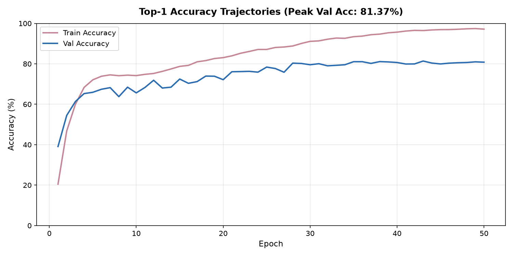
</p>
<p align="center">
  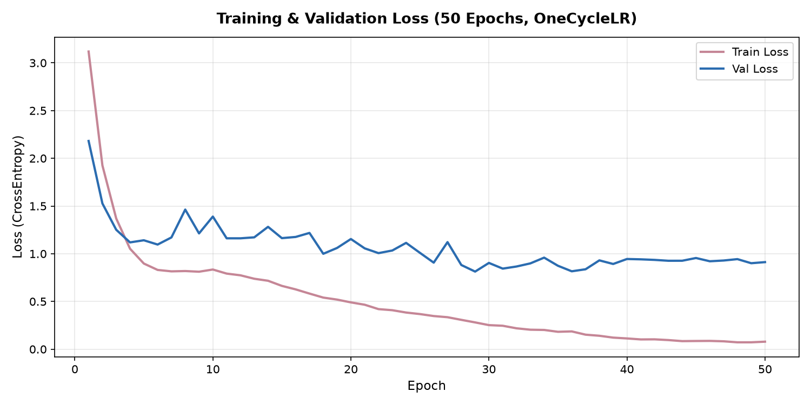
</p>

**Where the errors go** — a 9×9 confusion matrix over the 1,696 test slices. Read the diagonal first; every off-diagonal cell is a case the product would send for a second opinion.

<p align="center">
  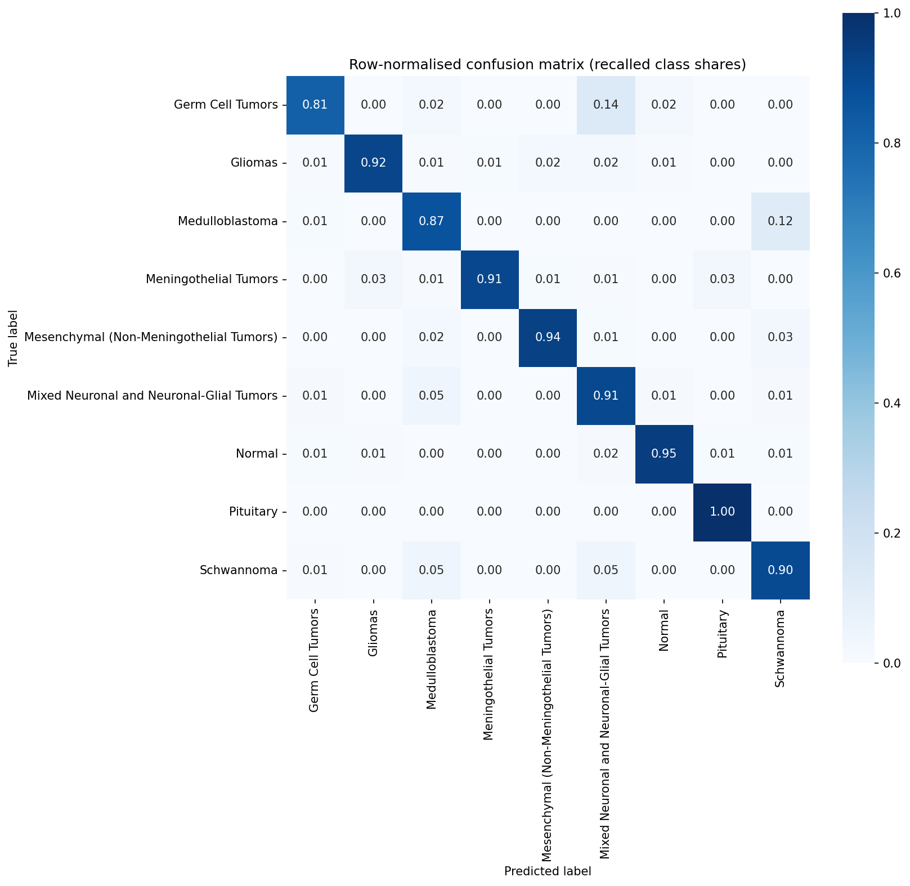
</p>

**Per-class discrimination** — ROC and precision-recall, one curve per class. PR is the honest view under imbalance: Germ Cell Tumors and Medulloblastoma sit lowest.

<p align="center">
  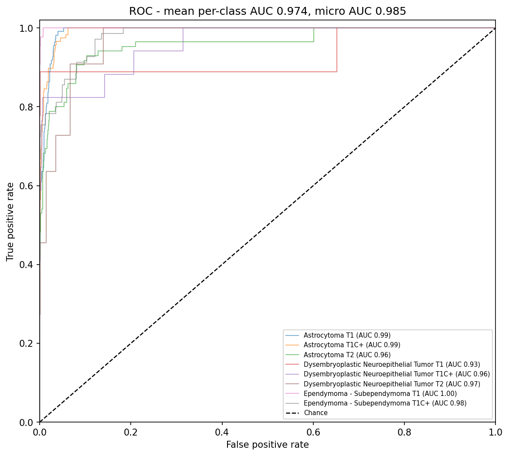
</p>
<p align="center">
  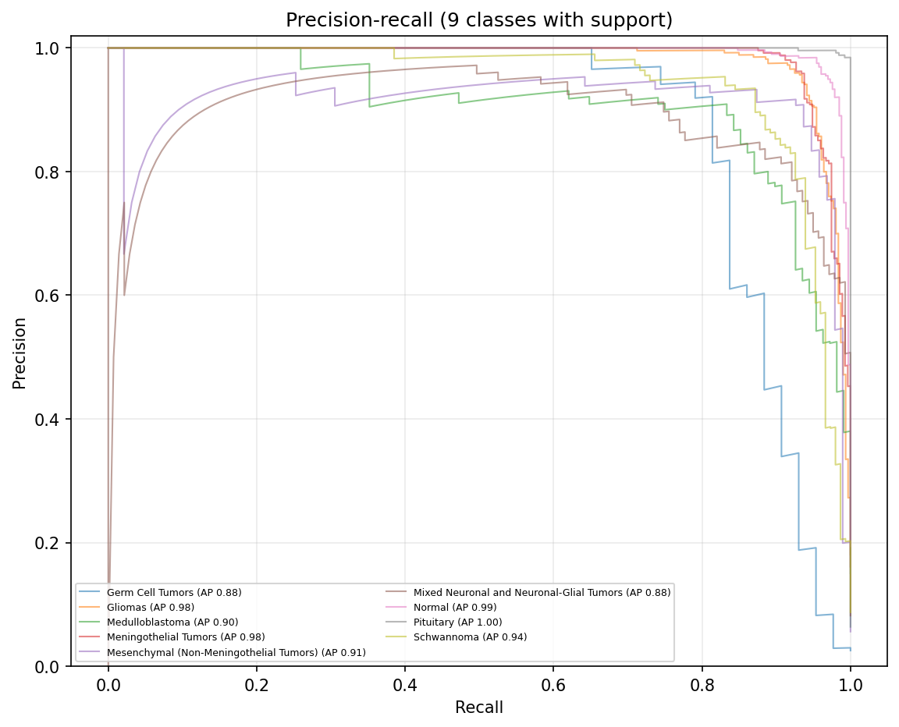
</p>

**Class balance across the three splits** — 9 classes, 11,128 images. The grouping rule keeps proportions close without ever splitting a source scan.

<p align="center">
  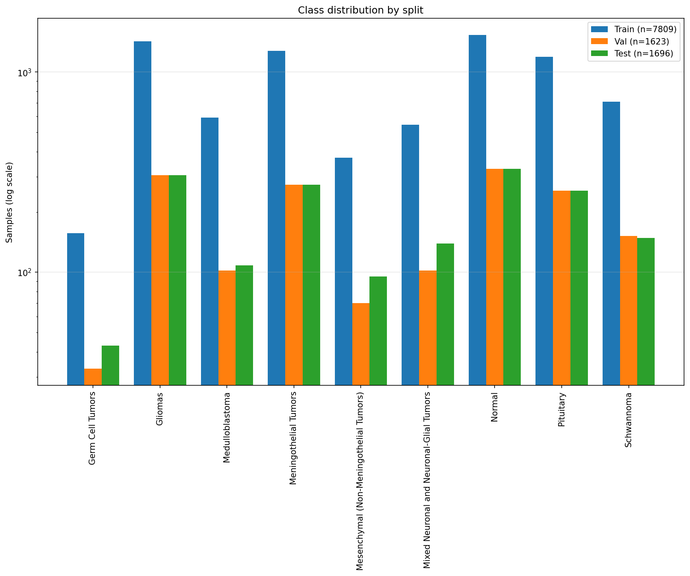
</p>

**What the model looks at** — Grad-CAM over eight test slices, one per class. The heat sits on the lesion, not on the skull or the scanner artefact.

<p align="center">
  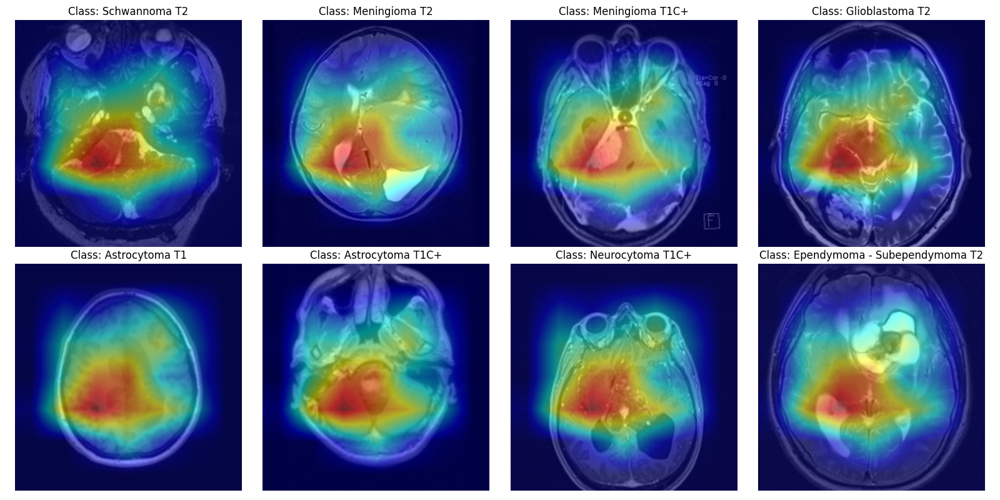
</p>

**Prediction grid** — predicted class, confidence and ground truth per panel. Read this one for the failure cases, not the successes.

<p align="center">
  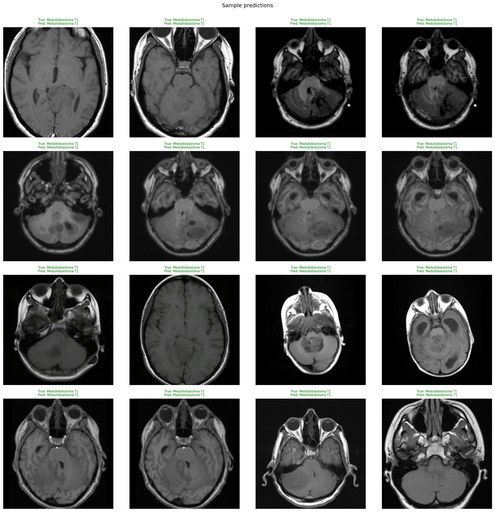
</p>

Machine-readable companions in the same folder: `classification_report.txt` (the table above), `metrics.json` (run config and headline numbers) and `split_manifest.csv` (every image → split, 11,128 rows).

### Segmentation — four MedNeXt runs

All four on the same combined corpus, same seed, same loss (BCE + Dice). The only thing that changed between them is listed.

| Run | Resolution | Epochs | wd / drop_path | Best composite | Val Dice (EMA) | OpenMed | BTSC |
|---|---|---:|---|---:|---:|---:|---:|
| `baseline-2026-10-11` | 256 | 22 | 0.01 / 0.05 | 0.6947 @12 | 0.6734 | 0.6522 | 0.7373 |
| `60ep-2026-10-11` | 256 | 59 | 0.01 / 0.05 | 0.6982 @17 | 0.6751 | 0.6520 | 0.7445 |
| `60ep-reg-2026-10-12` | 256 | 36 | **0.05 / 0.15** | 0.6975 @16 | 0.6746 | 0.6516 | 0.7435 |
| **`512-final-2026-10-13`** | **512** | 34 | 0.05 / 0.15 | **0.7101 @19** | **0.6866** | 0.6631 | **0.7572** |

**What the progression says:** longer training bought +0.0035, stronger regularisation bought −0.0007 (nothing), and **resolution bought +1.2 Dice** — the only change that mattered. Batch had to drop 16 → 4 with gradient accumulation 4 to fit 512 px, and it still won.

**Where it is weak:** OpenMed Dice 0.663 vs BTSC 0.757. The OpenMed volumes are harder — different acquisition, smaller lesions — and the gap has been stable across all four runs, so it is data, not tuning.

### 📊 Segmentation figures

**Learning curves** — loss and Dice per epoch for the 512 px run. Validation is plotted on its EMA weights, which is what the checkpoint stores.

<p align="center">
  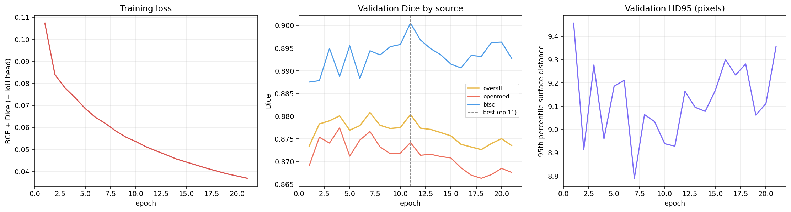
</p>

**Schedule** — 2-epoch linear warmup into cosine decay. The flat middle explains the patience setting: across epochs 10–29 validation Dice spans only **0.6786–0.6866**, a range of 0.008, so a short patience stops the run before the tail.

<p align="center">
  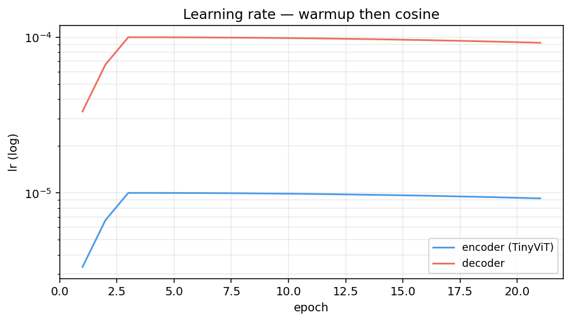
</p>

**Per-case spread** — test Dice across cases. The mean is 0.6866; the distribution is what that number hides, and the left tail is the part a clinician would notice.

<p align="center">
  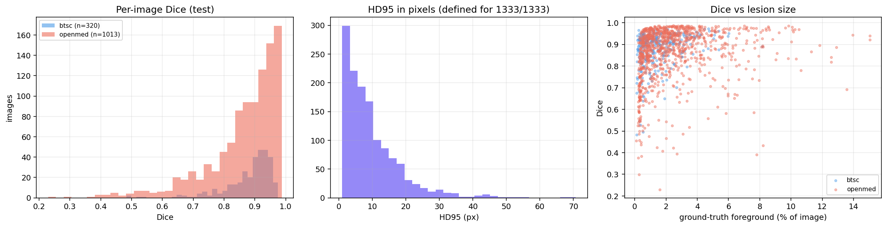
</p>

**Calibration** — IoU against predicted confidence. A perfectly calibrated head lies on the diagonal; points below it mean the model is more confident than it is accurate. This is why the served output reports Dice rather than a probability.

<p align="center">
  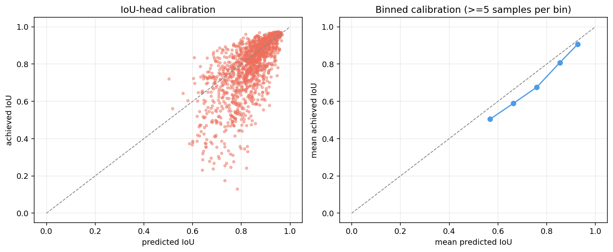
</p>

**Run over run** — the four configurations side by side. Resolution is the only line that separates from the cluster.

<p align="center">
  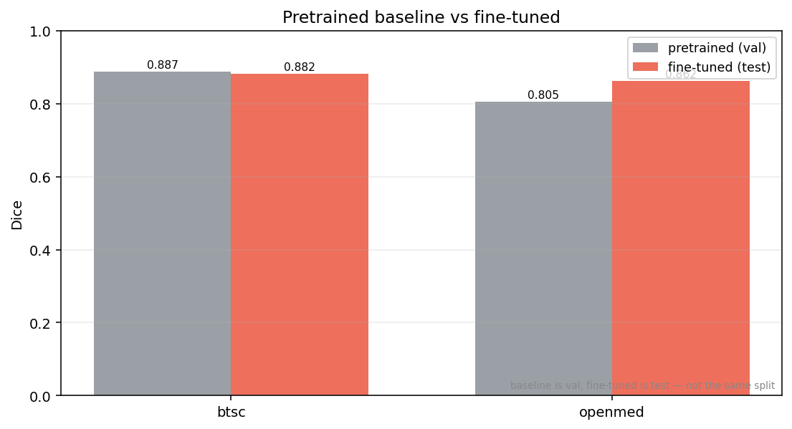
</p>

### Assistive — LiteMedSAM

TinyViT-256 encoder, 38 MB, box-prompted only. Trained weights accept points and dense masks at the architecture level but were never trained on them — a dense prompt returns an empty prediction. The lab exposes boxes only, for that reason.

This is a **lab instrument**, not part of the diagnostic path: it shows what a promptable model does with a user-drawn box, next to the trained segmenter.

### What the numbers cost

| Decision | Alternative rejected | Consequence |
|---|---|---|
| Grouped splits | stratified-by-class splits | test top-1 fell 0.97 → 0.727; the first number was leakage |
| 9 classes | keep 42 (type × sequence) | −5 points of headroom, +1 reliable label |
| MedNeXt at 512 | 256 with bigger batch | 34 epochs instead of 59, +1.2 Dice |
| Grouping by verified series | grouping by filename stem | 18 shared-prefix stems rejected; 1,254 unrelated scans kept separate |
| Ship `brain_best_model` on val loss | ship best accuracy | the two checkpoints differ by <0.1 point; val loss is the calmer signal |

---

## 🔒 Invariants

Enforced in code, covered by `backend/tests`. Breaking them is what caused the incidents above.

**1. A checkpoint and its class names must agree exactly.** `label_space.py` owns the only copy of the class list. `resolve_label_space()` binds a head width to names and raises on disagreement; the pipeline converts that into `ModelUnavailableError` → HTTP 503. Nothing resizes a model to fit a mismatched checkpoint.

**2. The label space travels with the weights.** Training writes `<checkpoint>.label_space.json` beside the `.pth` with `class_names`, `model_tag` and run `metrics`. Deploying means copying **both**. Without the sidecar the service runs on the canonical list and reports `label_space_source: "canonical (unverified)"`.

**3. Splits never share a source scan.** `get_stratified_splits` groups before assigning and raises if a group lands in two splits. Two images are the same group when byte-identical, or when they share a numeric stem **and** adjacent 32×32 correlation ≥ 0.90. The correlation test matters: stems alone would have merged 1,254 unrelated scans sharing the `Siar_healthy_N` prefix.

**4. Explanation rendering is shared code.** `overlay_cam_on_image` and `GradCAM` serve both the API and the training artefacts. `GradCAM` keeps hooks for its lifetime — use it as a context manager.

**5. Coordinates are millimetres at the boundary.** The registry is authored in normalised `[-1,1]³` and converted by `to_mni_mm` before leaving the API. `locations_3d[].probability` is a presentation prior scaled by confidence — never a lesion measurement. `localization_basis` says so.

**6. Train and inference preprocessing are the same object.** Both come from `resolve_model_data_config(model)`: 208×208 bicubic at `crop_pct` 0.89, not the 512×512 stored on disk.

---

## ⚙️ Configuration

| Variable | Purpose | Default |
|---|---|---|
| `OPENMED_BRAIN_CHECKPOINT` | Weights to serve | `classification/checkpoints/brain_best_model.pth` |
| `OPENMED_BRAIN_DATASET` | Dataset root for training and `/model-info` counts | — |
| `OPENMED_BRAIN_OUTPUT` | Run output directory | `.` (`/kaggle/working` on Kaggle) |
| `OPENMED_CORS_ORIGINS` | Allowed browser origins | local Vite dev origins |
| `VITE_BRAIN_API_BASE` | Frontend API base | `http://localhost:8016/api/brain` |

---

## 🛠 Tech Stack

**Languages**


**Frameworks & Libraries**


**Data & Compute**


**DevOps / Tools**


---

## 📦 Dependencies

<details open>
<summary><b>Runtime Dependencies</b></summary>

| Package | Version | Role |
|---|---|---|
| [](https://pypi.org/project/fastapi/) | `>=0.103.0` | HTTP router, response models |
| [](https://pypi.org/project/uvicorn/) | `>=0.23.0` | ASGI server |
| [](https://pypi.org/project/python-multipart/) | `>=0.0.6` | File upload parsing |
| [](https://pypi.org/project/torch/) | `>=2.0.0` | Model execution, Grad-CAM autograd |
| [](https://pypi.org/project/torchvision/) | `>=0.15.0` | Transforms, backbone ops |
| [](https://pypi.org/project/timm/) | `>=0.9.7` | EfficientNetV2-B2 + data config |
| [](https://pypi.org/project/gdown/) | `>=5.0.0` | Weight download |
| [](https://pypi.org/project/Pillow/) | `>=10.0.0` | Image I/O |
| [](https://pypi.org/project/opencv-python-headless/) | `>=4.8.0` | CAM overlay, morphology |
| [](https://pypi.org/project/numpy/) | `>=1.24.0` | Array ops |
| [](https://pypi.org/project/pandas/) | `>=2.1.0` | Manifests, metrics tables |
| [](https://pypi.org/project/scikit-learn/) | `>=1.3.0` | AUC, classification report |
| [](https://pypi.org/project/scipy/) | `>=1.11.0` | Distance transforms, morphology |
| [](https://pypi.org/project/matplotlib/) | `>=3.8.0` | Training figures |
| [](https://pypi.org/project/seaborn/) | `>=0.12.0` | Confusion matrices |
| [](https://pypi.org/project/tqdm/) | `>=4.66.0` | Progress bars |
| [](https://pypi.org/project/torchxrayvision/) | `>=1.2.0` | Lungs organ; unused here |

</details>

<details>
<summary><b>Dev / Build / Test Dependencies</b></summary>

| Package | Version | Role |
|---|---|---|
| [](https://pypi.org/project/pytest/) | latest | 40 tests: splits, label space, Grad-CAM, HTTP |
| [](https://pypi.org/project/ruff/) | latest | Lint (`backend/ruff.toml`) |
| [](https://www.npmjs.com/package/vite) | `^7` | Frontend build |
| [](https://www.npmjs.com/package/typescript) | `~5.9` | Type checking |
| [](https://www.npmjs.com/package/oxlint) | latest | Frontend lint |

</details>

---

## 🤝 Contributing

Fork, branch, and open a PR against `master`.

- **Style:** `ruff check backend` and `npm run lint` must pass; Python is typed, TS is strict.
- **Tests:** `cd backend && python -m pytest` — 40 tests. Any change to splitting, label space or Grad-CAM needs one.
- **Bug reports:** include the run's `metrics.json` and `split_manifest.csv` when the issue is numeric. A number without its manifest cannot be checked.
- **Feature requests:** state which invariant the change touches, if any.

No `CONTRIBUTING.md` exists at the repository root yet. Until it does, the rules above are the contract: `ruff`, `pytest`, and a manifest with every numeric claim.

---

## 📜 License

**No LICENSE file at the repository root yet.** Until one is added, the default applies: all rights reserved, and reuse needs the author's permission. Do not assume MIT.

---

## 🛡 Security

Report vulnerabilities privately via [GitHub Security Advisories](https://github.com/H0NEYP0T-466/OpenMed/security/advisories/new). Do not open a public issue for anything exploitable. No `SECURITY.md` exists at the repo root yet.

---

## 📏 Code of Conduct

No `CODE_OF_CONDUCT.md` exists at the repo root yet. The intent is Contributor Covenant v2.1: assume it applies, and report unacceptable behaviour to the maintainers.

---

<p align="center">Made with ❤ by <a href="https://github.com/H0NEYP0T-466">H0NEYP0T-466</a></p>
